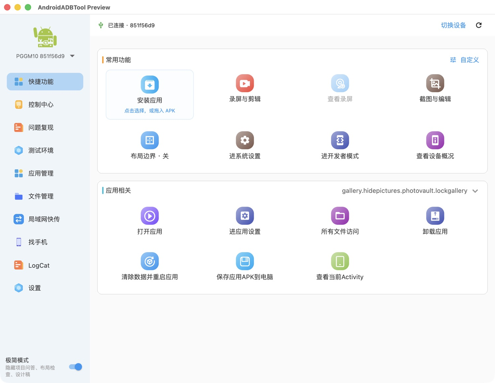
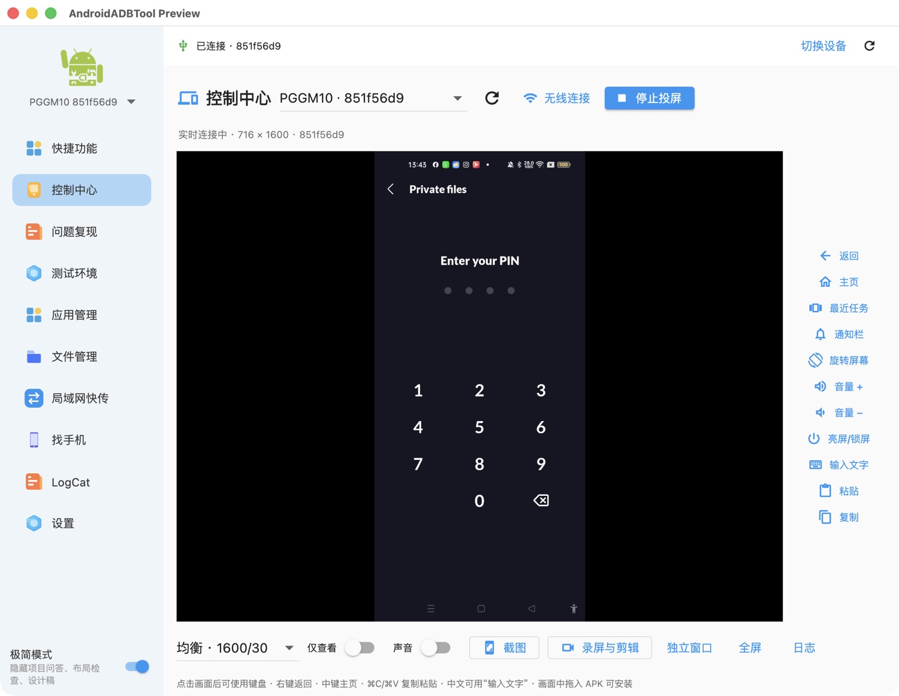
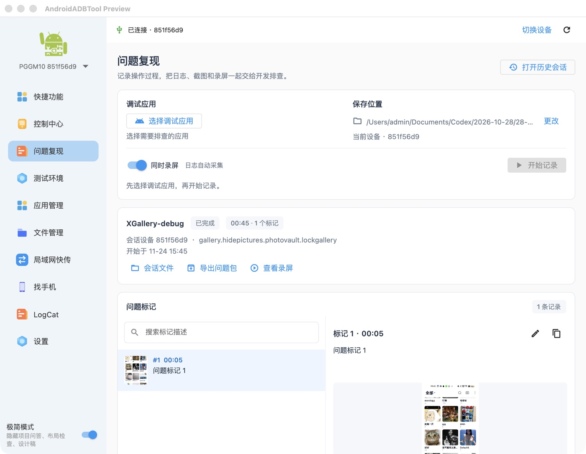
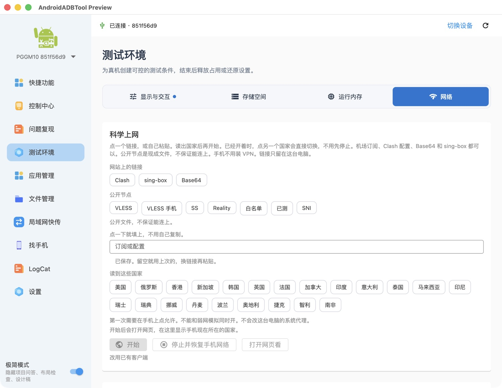
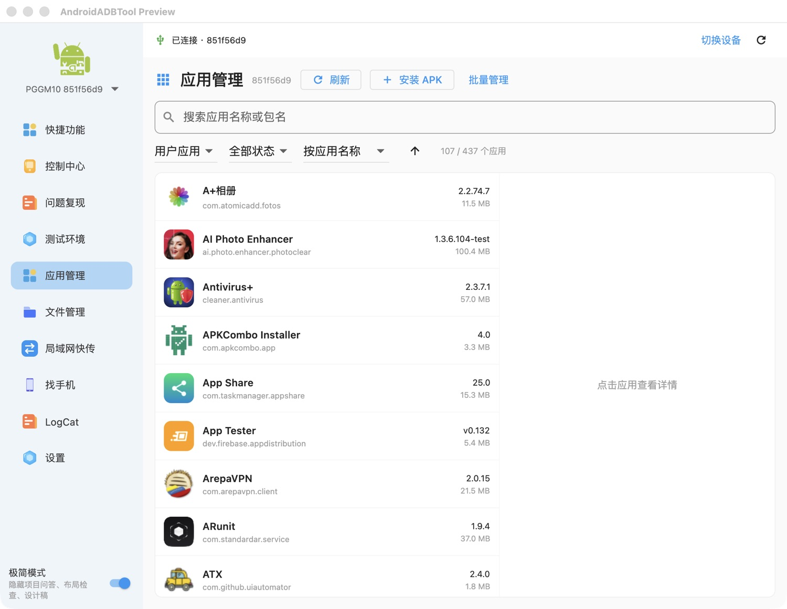
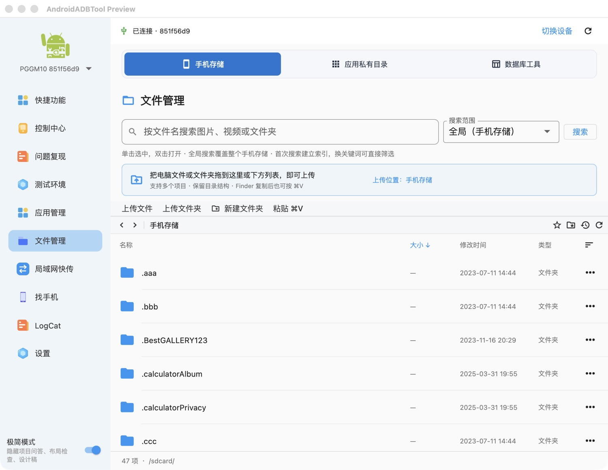
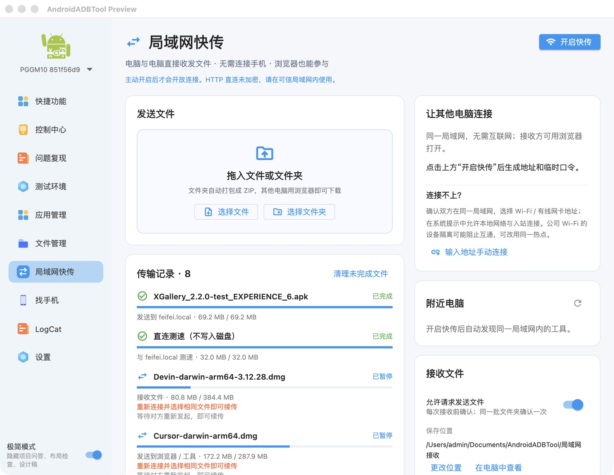
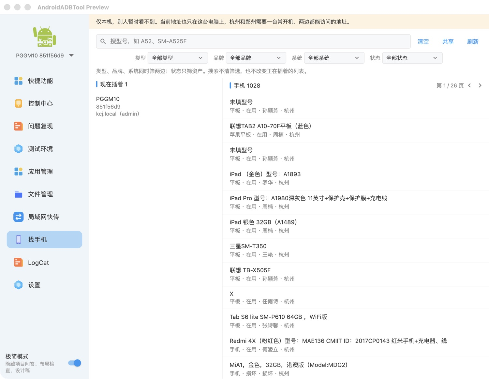
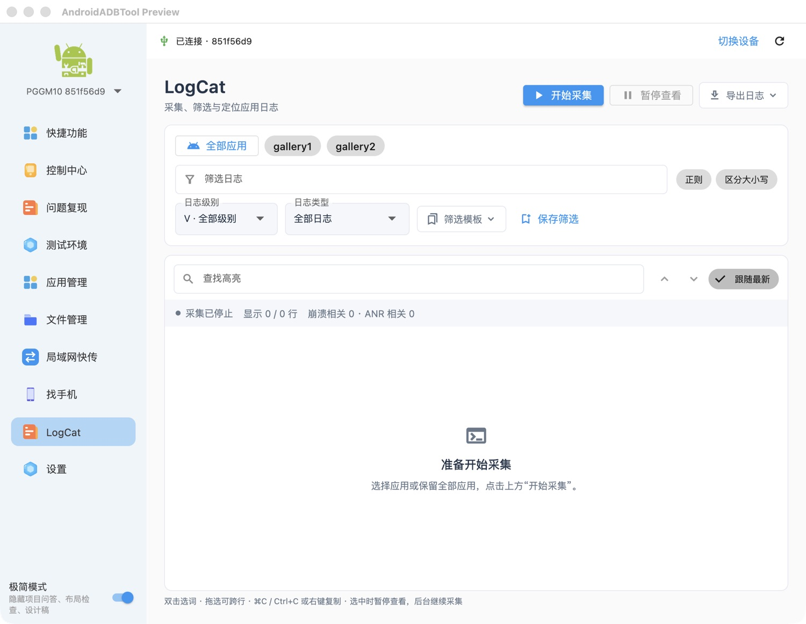

# AndroidADBTool 使用说明

图文以 Mac 版为例。Windows 测试版的投屏和录屏使用独立窗口，部分 Mac 原生功能尚未适配。

## 安装与连接

1. Mac：从 [Releases](https://github.com/zj-kechangjie/android_tool_plus-updates/releases/latest) 下载 DMG，将应用拖入“应用程序”。首次启动被拦截时，先尝试打开，再到“系统设置 → 隐私与安全性 → 安全性”选择“仍要打开”。
2. Windows：下载 Windows x64 ZIP，完整解压后运行 `AndroidADBTool.exe`，保留同目录的 DLL、data、platform-tools 和 scrcpy 文件夹。
3. 手机开启“开发者选项 → USB 调试”，使用数据线连接并解锁，在手机上确认调试授权。工具会自动查找 ADB。

## 目录

- [快捷功能](#快捷功能)
- [控制中心](#控制中心)
- [问题复现](#问题复现)
- [测试环境](#测试环境)
- [应用管理](#应用管理)
- [文件管理](#文件管理)
- [局域网快传](#局域网快传)
- [找手机](#找手机)
- [LogCat](#logcat)
- [设置](#设置)

## 快捷功能

连上手机后的常用动作。安装、截图、录屏、打开应用都在这一页。

1. **安装应用**。选一个 APK，或拖进「点击选择，或拖入 APK」。应用管理里也有安装。
2. **录屏与剪辑**。录手机画面，录完可以剪一段再导出。
3. **查看录屏**。没在录的时候，按钮是这个名字。打开已经录好的画面。
4. **截图与编辑**。可以标注、识别文字和对比截图。默认线宽为 3px；点「重新截图」在原窗口更新画面，获取成功才替换旧标注。复制成功显示提示，短操作不再反复使整排按钮变灰。
5. **自定义**。自己挑哪些按钮放进常用功能。
6. **布局边界**。查看布局边界。
7. **进系统设置**。打开手机的系统设置。
8. **进开发者模式**。打开开发者选项。
9. **查看设备概况**。看这台手机的概况。
10. **打开应用**。拉起当前调试包，不用先去应用管理里翻。
11. **进应用设置**。打开这个包的应用信息。
12. **所有文件访问**。打开所有文件访问。
13. **卸载应用**。卸掉当前调试包。
14. **清除数据并重启应用**。清掉数据再拉起来。
15. **保存应用 APK 到电脑**。把手机上这个包拉回电脑。
16. **查看当前 Activity**。看现在前台是哪个界面。

## 控制中心

实时看手机画面，并在画面上操作。

1. **实时连接中**。这一条亮着，才表示画面在播。只是 adb 能看到设备，不等于正在投屏。
2. **无线扫码连接**。手机和电脑接入同一局域网，在手机「开发者选项 → 无线调试 → 使用二维码配对设备」里扫描工具二维码，自动配对并连接。请勿使用普通相机或微信扫码；二维码过期可刷新，也可切换配对码或手动连接。Android 11 及以上支持此方式，实机扫码兼容性仍待进一步验证。
3. **停止投屏**。在「无线连接」那一排。停掉只停画面，手机还连着。
4. **返回、主页、最近任务、通知栏**。常用导航，在画面右侧。
5. **旋转屏幕**。旋转不再把正在进行的录屏打断。
6. **音量、亮屏/锁屏、声音**。调手机音量、亮屏或锁屏、开关投屏声音。
7. **输入文字、粘贴、复制**。中文用「输入文字」，不要指望直接敲中文进手机。
8. **截图**。从当前画面抓一张，进编辑。没在投屏时不可用，改走快捷功能。
9. **录屏与剪辑**。Mac 优先录制投屏画面，失败后自动尝试兼容录制和电脑画面兜底。兜底输出无声 MOV（最长边 1280 像素、最高 15fps，文件较大），切换时保留前段并另存续录，不会无缝合并。
10. **均衡 · 1600/30**。画质档，不是右边的「仅查看」。
11. **仅查看**。不把键鼠操作送进手机。只想看、不想误触时打开。
12. **独立窗口、全屏**。把投屏拆出去，或铺满。
13. **底部提示**。点画面后可以用键盘。右键返回，中键主页。把 APK 拖进画面可以安装。

## 问题复现

记录一次问题。可以同时留画面和日志，再导出问题包。

1. **打开历史会话**。回到以前记过的一次。
2. **选择调试应用**。没选不能开始。选错包，日志会对不上。
3. **保存位置**。这一次的文件放在哪。可以更改。
4. **开始记录**。从这一刻记。先把手机摆到复现前的页面再点。
5. **同时录屏 · 日志自动采集**。勾上后，这一段画面和日志在同一个问题里。
6. **问题标记**。复现发生的那一下点一下，后面对日志有个时间点。可以搜标记描述。
7. **导出问题包**。导出的是这一次的包，不是整个日志缓冲。旁边可以查看录屏、打开会话文件。

## 测试环境

给真机造测试条件。网络里可以科学上网，也可以模拟弱网。

1. **网络**。第四个页。科学上网和弱网模拟都在这里。
2. **网站上的链接**。Clash、Base64、sing-box，或公开节点。公开节点不保证能连上。点一下就填上。
3. **国家**。从这条链接读出来的，不是固定菜单。图里的国家只是当时那条链接。换一条，国家会变。
4. **订阅或配置**。已保存的会留着。留空就用上次的，换链接再粘贴。
5. **开始**。读出国家后再点。第一次需要在手机上点允许。开始后会打开网页，在这里显示手机现在所在的国家。
6. **停止并恢复手机网络**。测完用这个停。不要只关工具。
7. **打开网页看**。核对手机现在的出口。这一页打不开，不算已经连上。状态栏图标只表示转发开着。
8. **改用已有客户端**。电脑上已经连好时用这个，填本地端口。不要把订阅链接填进端口。

## 应用管理

搜索、安装、管理手机上的应用。

1. **搜索应用名称或包名**。装了很多包时用这个，不用翻列表。
2. **安装 APK**。和快捷功能里的安装是同一件事。
3. **刷新、批量管理**。重新读列表，或一次处理多台应用。
4. **107 / 437 个应用**。当前筛出来的数量 / 手机上的总数。只是计数。
5. **用户应用、按应用名称、全部状态**。缩小列表。图里是按名称排的用户应用。

## 文件管理

浏览手机文件，上传和下载。

1. **手机存储**。当前所在的根。旁边可以切数据库工具、应用私有目录。
2. **应用私有目录**。进当前应用自己的目录，不用在存储根上翻。
3. **搜索**。按文件名搜图片、视频或文件夹。全局搜索覆盖整个手机存储。
4. **拖到这里**。文件或文件夹拖到这块，或拖到下方列表，即可上传。拖到列表里的某一个子文件夹上，仍然不会进那个文件夹。
5. **上传位置**。图里是「手机存储」。先点进目标目录，再拖。
6. **上传文件、上传文件夹、新建文件夹、粘贴**。不拖也可以从这里进。

## 局域网快传

同一局域网里，电脑之间传文件。

1. **开启快传**。主动开了才接受连接。文件夹会自动打成 ZIP。传了一半断了，可以续。
2. **拖入文件或文件夹**。丢进这块就进待传列表。也可以选择文件、选择文件夹。
3. **附近电脑**。同一局域网里开着快传的机器。公司 Wi-Fi 若开了设备隔离，互通不了，改用同一热点。
4. **输入地址手动连接**。发现不到时，自己填地址。
5. **传输记录**。看已经传完的。旁边可以清理未完成文件。
6. **HTTP 直连未加密**。只在可信局域网里用。不要把包丢到公共网络上再开。

## 找手机

按型号找测试机，并看现在插在哪台电脑。

1. **仅本机提示**。共享服务没连上时，仍显示这台电脑上插着的设备，并写明别人暂时看不到。地址在「共享」里配，不放在主流程。
2. **搜型号**。占位是「搜型号，如 A52、SM-A525F」。营销名和型号代号都能搜。领取人、地点也能搜。资产号不是主路径。搜索不清筛选，也不改变正在插着的列表，并回到第 1 页。
3. **类型、品牌、系统、状态**。类型、品牌、系统同时筛两边。状态只筛资产。系统可以选范围（8–12、13 及以上、7 及以下、没填版本）或单个大版本。
4. **现在插着**。按序列号，不是按资产号。这一行是型号、序列号、这台电脑和使用者。心跳大约 1–2 分钟一次；停了大约 3 分钟就不再显示「正在插着」。两台电脑同时报同一个序列号，会用红字写出来，不静默覆盖。
5. **资产列表**。主行只显示型号。资产号不在标题里。点开详情才有资产号、领取人、状态、地点、系统、备注。
6. **分页**。默认就有列表，不用先搜。图里是第 1 / 26 页。搜索、筛选、清空都回到第 1 页。

## LogCat

看运行日志。

1. **全部应用、gallery1、gallery2**。按包过滤。采集中不能切，先停再换。
2. **开始采集、暂停查看**。选中文字时只是暂停查看，后台继续收。
3. **筛选日志**。日志类型、日志级别、区分大小写、正则。常用的可以保存筛选，或套筛选模板。
4. **查找高亮**。在已采到的缓冲里找词，命中会亮出来。旁边可以跟随最新。
5. **选词**。双击选词，拖选可跨行。⌘C / Ctrl+C 或右键复制。选中时暂停查看，后台继续采集。

## 设置

检查更新、极简模式和 ADB 路径。

1. **应用更新**。优先增量更新，失败再下完整包。安装前先保存编辑，结束正在进行的录屏、导出或文件传输。
2. **极简模式**。默认开着。侧栏底部写着「隐藏项目问答、布局检查、设计稿」。设置里写全：还会藏起快捷功能里的系统相关、按键相关、屏幕输入和埋点调试。常用功能里的录屏、进系统设置仍保留。
3. **ADB 路径**。可以自动查找，也可以自己选 adb 文件。保存后用于连接和调试。
4. **使用说明**：在“设置 → 应用更新”点击“使用说明”，用默认浏览器打开本页。
